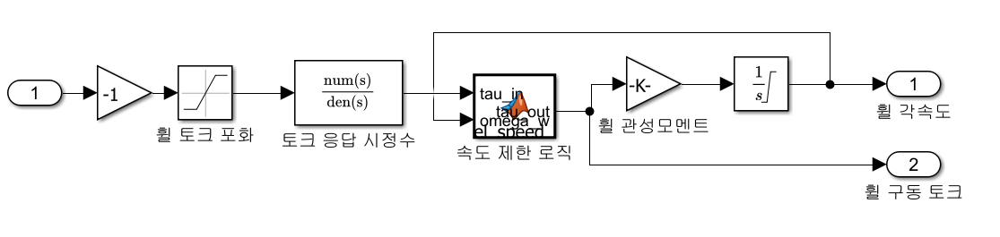

# 리액션 휠을 활용한 PD 제어 기반 3축 자세제어

MATLAB/Simulink 기반의 **PD 제어기와 3축 리액션 휠을 이용한 CubeSat 자세제어 시뮬레이션**입니다.

쿼터니언 기반 자세 오차를 계산하고, PD 제어기를 통해 생성된 제어 토크를 X, Y, Z축 리액션 휠에 전달하여 위성의 자세를 목표 각도로 수렴시키는 폐루프 자세제어 시스템을 구현하였습니다.

## 1. 시스템 개요

전체 자세제어 시스템은 다음 세 가지 주요 서브시스템으로 구성됩니다.

- **PD 제어기:** 목표 자세와 현재 자세의 오차를 계산하여 제어 토크 생성
- **리액션 휠:** 제어 토크에 따라 3축 리액션 휠을 구동하고 휠 각속도 및 구동 토크 계산
- **큐브샛 동역학:** 리액션 휠의 구동 토크를 반영하여 위성의 각속도와 자세 변화 계산

각 서브시스템은 피드백 구조로 연결되며, 본체의 자세와 각속도를 제어기로 전달합니다.

## 2. PD 제어기

위성의 목표 자세와 현재 자세를 쿼터니언으로 표현하고, 두 쿼터니언 사이의 자세 오차를 계산합니다.

계산된 쿼터니언 오차에 비례 이득(Kp)을 적용하고, 본체 각속도에 미분 이득(Kd)을 적용하여 본체 요구 토크를 생성합니다.

### Controller Parameters

| 파라미터 | 값 |
|---|---|
| Kp | 0.004 |
| Kd | 0.02 |
| Attitude | Quaternion |
| Euler Rotation Order | XYZ |
| Control Method | PD Control |

## 3. 리액션 휠

PD 제어기에서 생성된 본체 요구 토크를 X, Y, Z축으로 분리하여 각 리액션 휠에 전달하도록 구성하였습니다.

각 리액션 휠은 입력된 토크 명령에 따라 휠 각속도와 휠 구동 토크를 계산하며, 세 축의 출력은 각각 통합되어 CubeSat 동역학 모델에 전달됩니다.

### 3-1. X축 휠

X축 리액션 휠은 PD 제어기에서 전달된 본체 요구 토크를 입력받아 휠 각속도와 휠 구동 토크를 계산하도록 구성하였습니다.

입력 토크는 부호 변환 후 **휠 토크 포화(Torque Saturation)** 및 **토크 응답 시정수** 블록을 거치며, 속도 제한 로직을 통해 휠의 회전속도 범위를 고려합니다.

이후 휠 관성모멘트를 적용하여 각가속도를 계산하고, 적분 블록을 통해 휠 각속도를 산출합니다. 계산된 휠 각속도는 속도 제한 로직으로 피드백됩니다.

**Y축과 Z축 리액션 휠에도 동일한 제어 및 동역학 구조를 적용**하여 3축 리액션 휠 시스템을 구성하였습니다.

## 4. CubeSat 동역학

CubeSat 동역학 모델은 리액션 휠 각속도와 휠 구동 토크를 입력받아 위성 본체의 각속도 및 자세를 계산합니다.

본체의 회전 운동은 3축 동역학 블록을 통해 계산하며, 계산된 각속도를 적분하여 본체 각속도를 갱신합니다.

또한 쿼터니언 미분 및 적분 과정을 통해 본체 자세를 계산하고, 쿼터니언 정규화 블록을 적용하였습니다.

계산된 본체 쿼터니언과 각속도는 PD 제어기로 피드백되어 목표 자세에 대한 오차를 지속적으로 보정합니다.

## 5. 시뮬레이션 결과

### 목표 자세

각 축의 목표 자세를 다음과 같이 설정하였습니다.

| 축 | 목표 각 |
|---|---|
| X축 | 5° |
| Y축 | 7° |
| Z축 | 10° |

- **시뮬레이션 시간:** 200 s
- **초기 상태:** [0°, 0°, 0°]
- **오일러 각 순서:** XYZ

### 응답 확인

시뮬레이션 결과, X, Y, Z축 모두 목표 자세로 안정적으로 수렴하는 것을 확인하였습니다.

- **X축:** 초기 0°에서 목표 자세 5°로 수렴
- **Y축:** 초기 0°에서 목표 자세 7°로 수렴
- **Z축:** 초기 0°에서 목표 자세 10°로 수렴

각 축에서 소규모 오버슈트가 발생하였으나 시간이 경과함에 따라 감소하였으며, 약 50~60초 이후에는 목표 자세 부근에서 안정적인 응답을 나타냈습니다.

200초 시뮬레이션 구간에서 세 축 모두 지속적인 진동이나 발산 없이 목표 자세를 유지하였습니다.

## 6. 결론

MATLAB/Simulink를 활용하여 **쿼터니언 기반 PD 제어기, 3축 리액션 휠, CubeSat 회전 동역학을 통합한 폐루프 자세제어 시스템**을 구현하였습니다.

시뮬레이션을 통해 목표 자세 [5°, 7°, 10°]에 대한 3축 자세제어 응답을 확인하였으며, 각 축이 목표 각도로 수렴하는 결과를 얻었습니다.

향후 실제 리액션 휠 하드웨어와의 연동 및 외란을 고려한 자세제어 성능 검증을 진행할 수 있습니다.

## 7. 개발 환경

- MATLAB
- Simulink
- MATLAB Function Blocks
- Quaternion to Rotation Angles (XYZ)

## 8. 모델 파일명

- `pd_to_wheel_main.slx` — 3축 CubeSat 자세제어 통합 Simulink 모델
