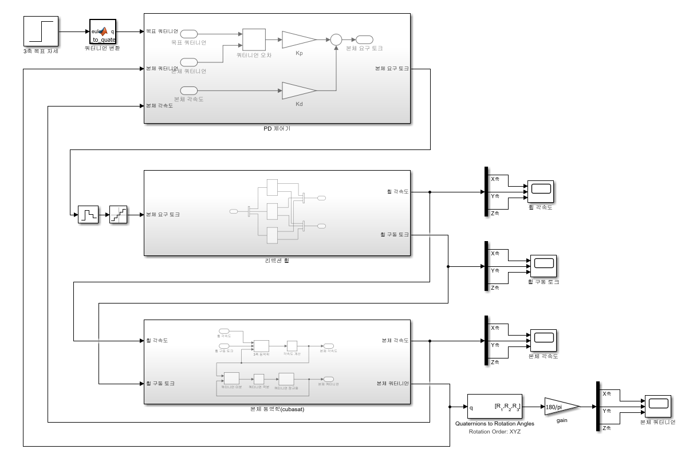
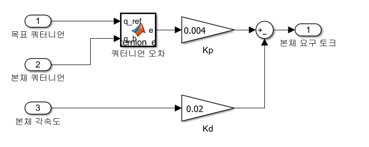
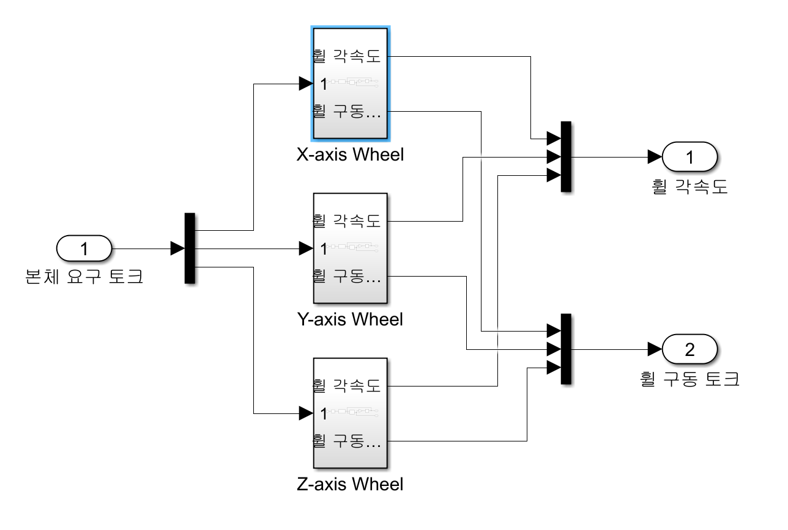
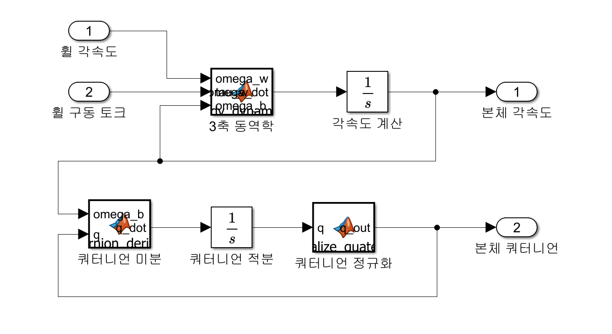
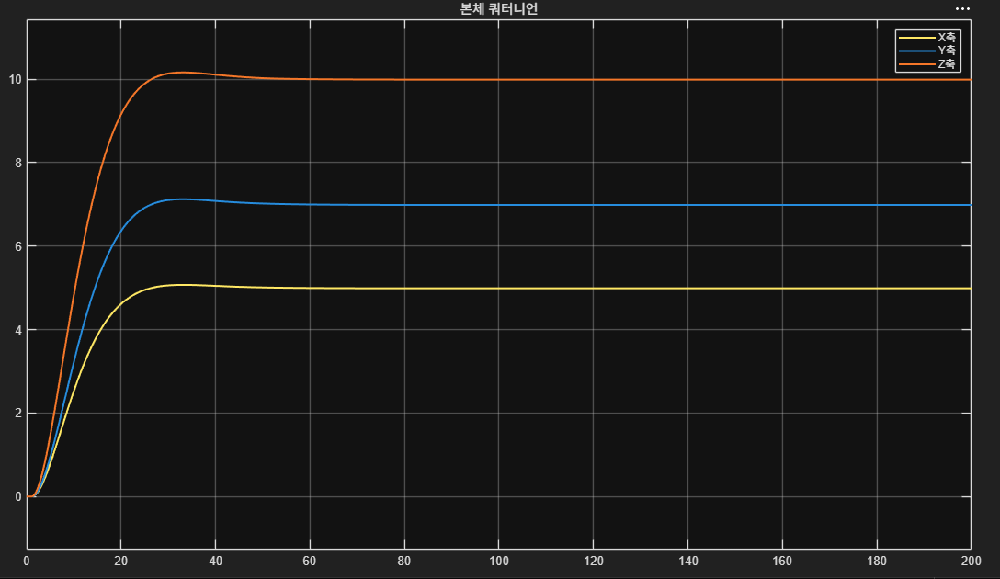

# CubeSat 3-Axis Attitude Control Using Reaction Wheels

MATLAB/Simulink 기반의 **PD 제어기와 3축 리액션 휠을 이용한 CubeSat 자세제어 시뮬레이션** 프로젝트입니다.

쿼터니언(Quaternion) 기반 자세 오차를 계산하고, PD 제어기를 통해 생성된 제어 토크를 X, Y, Z축 리액션 휠에 전달하여 위성의 자세를 목표 각도로 수렴시키는 폐루프(Closed-loop) 자세제어 시스템을 구현하였습니다.

## 1. System Overview

전체 자세제어 시스템은 다음 세 가지 주요 서브시스템으로 구성됩니다.

- **PD Controller:** 목표 자세와 현재 자세의 오차를 계산하여 제어 토크 생성
- **Reaction Wheel:** 제어 토크에 따라 3축 리액션 휠을 구동하고 휠 각속도 및 구동 토크 계산
- **CubeSat Dynamics:** 리액션 휠의 구동 토크를 반영하여 위성의 각속도와 자세 변화 계산

각 서브시스템은 피드백 구조로 연결되며, 본체의 자세와 각속도를 실시간으로 제어기에 전달합니다.

## 2. PD Attitude Controller

위성의 목표 자세와 현재 자세를 쿼터니언으로 표현하고, 두 쿼터니언 사이의 자세 오차를 계산합니다.

계산된 자세 오차와 본체 각속도를 이용하여 PD 제어 토크를 생성합니다.

제어 법칙은 다음과 같습니다.

\[
\boldsymbol{\tau}_{cmd}
=K_p\mathbf{e}_q-K_d\boldsymbol{\omega}_b
\]

여기서,

- \(\boldsymbol{\tau}_{cmd}\): 본체 요구 제어 토크
- \(K_p\): 비례 제어 이득
- \(K_d\): 미분 제어 이득
- \(\mathbf{e}_q\): 쿼터니언 기반 자세 오차 벡터
- \(\boldsymbol{\omega}_b\): 위성 본체 각속도

### Controller Parameters

| Parameter | Value |
|---|---|
| Proportional Gain (Kp) | 0.004 |
| Derivative Gain (Kd) | 0.02 |
| Attitude Representation | Quaternion |
| Euler Rotation Order | XYZ |
| Control Method | PD Control |

## 3. Three-Axis Reaction Wheel

PD 제어기에서 생성된 3축 제어 토크를 X, Y, Z축 리액션 휠에 각각 전달하도록 구성하였습니다.

각 리액션 휠 모델은 입력 제어 토크에 따른 휠 구동 토크와 각속도를 계산합니다.

실제 리액션 휠의 동작 범위를 고려하여 토크 및 회전속도 제한을 적용하였으며, 제어 명령의 이산화와 구동 응답 특성을 모델에 반영하였습니다.

### Reaction Wheel Parameters

| Parameter | Value |
|---|---|
| Reaction Wheel | MomentumSpace mRE-005-P 기반 |
| Number of Wheels | 3 (X, Y, Z) |
| Maximum Torque | ±1 mN·m |
| Maximum Wheel Speed | ±6000 RPM |
| Assumed Time Constant | 0.05 s |
| Control Update Period | 0.2 s |
| Torque Quantization | 1×10⁻⁶ N·m |

## 4. CubeSat Attitude Dynamics

CubeSat 동역학 모델은 리액션 휠 각속도와 구동 토크를 입력받아 위성 본체의 각속도 및 자세를 계산합니다.

본체의 회전 운동은 강체 회전 동역학을 기반으로 구현하였으며, 각속도를 적분하여 본체의 운동 상태를 갱신합니다.

또한 쿼터니언 미분 방정식을 통해 본체 자세를 계산하고, 수치 적분 과정에서 발생할 수 있는 오차를 줄이기 위해 쿼터니언 정규화를 적용하였습니다.

\[
\dot{\mathbf{q}}=\frac{1}{2}\Omega(\boldsymbol{\omega}_b)\mathbf{q}
\]

계산된 쿼터니언과 본체 각속도는 PD 제어기로 피드백되어 목표 자세에 대한 오차를 지속적으로 보정합니다.

## 5. Simulation Results

### Target Attitude

각 축의 목표 자세를 다음과 같이 설정하였습니다.

| Axis | Target Angle |
|---|---|
| X-axis | 5° |
| Y-axis | 7° |
| Z-axis | 10° |

- **Simulation Time:** 200 s
- **Initial Attitude:** [0°, 0°, 0°]
- **Euler Rotation Sequence:** XYZ

### Attitude Response

시뮬레이션 결과, X, Y, Z축 모두 목표 자세로 안정적으로 수렴하는 것을 확인하였습니다.

- **X-axis:** 초기 0°에서 목표 자세 5°로 수렴
- **Y-axis:** 초기 0°에서 목표 자세 7°로 수렴
- **Z-axis:** 초기 0°에서 목표 자세 10°로 수렴

각 축에서 소규모 오버슈트가 발생하였으나 시간이 경과함에 따라 감소하였으며, 약 50~60초 이후에는 목표 자세 부근에서 안정적인 응답을 나타냈습니다.

200초 시뮬레이션 구간에서 세 축 모두 지속적인 진동이나 발산 없이 목표 자세를 유지하였습니다.

## 6. Conclusion

본 프로젝트에서는 MATLAB/Simulink를 활용하여 **쿼터니언 기반 PD 제어기, 3축 리액션 휠, CubeSat 회전 동역학을 통합한 폐루프 자세제어 시스템**을 구현하였습니다.

시뮬레이션을 통해 목표 자세 [5°, 7°, 10°]에 대한 3축 자세제어 응답을 확인하였으며, 각 축이 목표 각도로 수렴하는 결과를 얻었습니다.

향후 실제 리액션 휠 하드웨어와의 연동 및 외란을 고려한 자세제어 성능 검증을 진행할 수 있습니다.

## 7. Development Environment

- MATLAB
- Simulink
- Aerospace Blockset 관련 회전 변환 블록
- MATLAB Function Blocks

## 8. Simulink Model

- `pd_to_wheel_main.slx` — 3축 CubeSat 자세제어 통합 Simulink 모델
